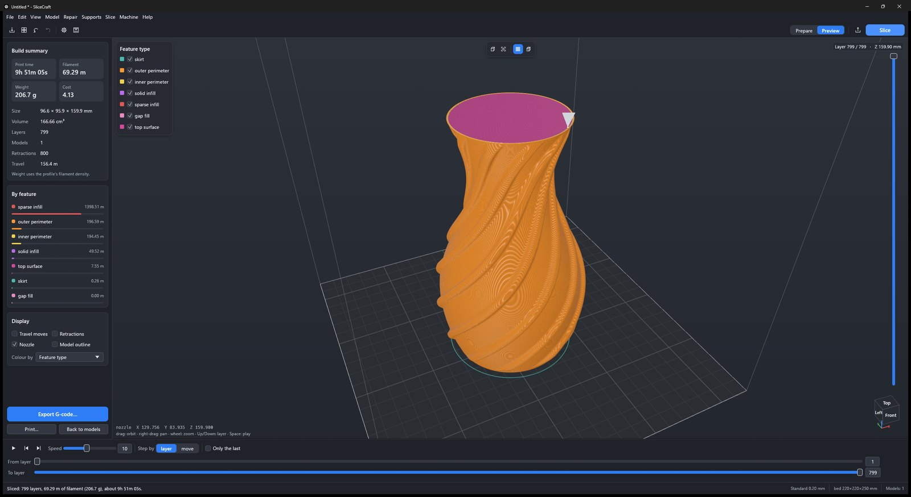
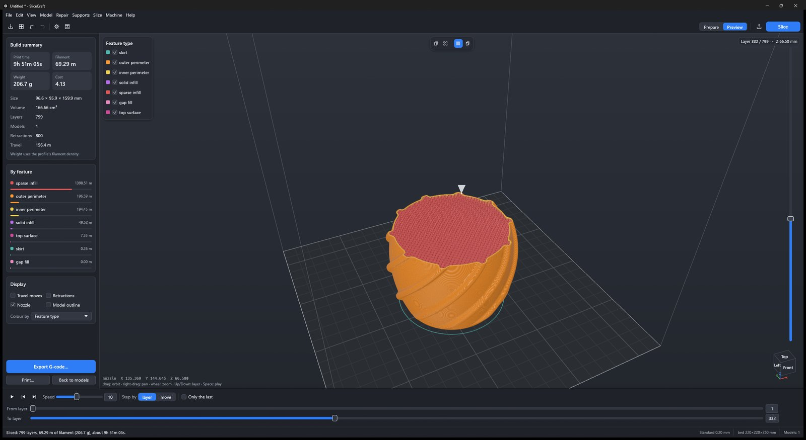
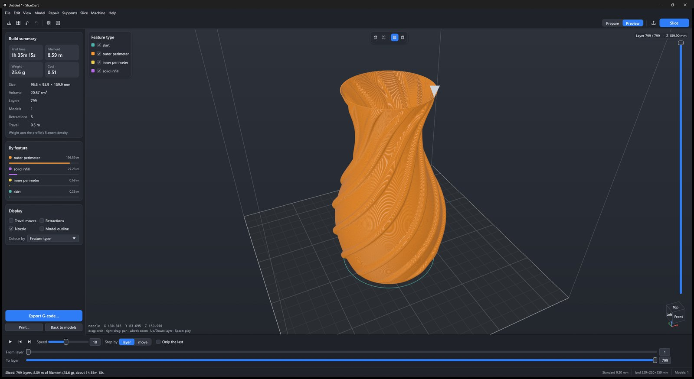
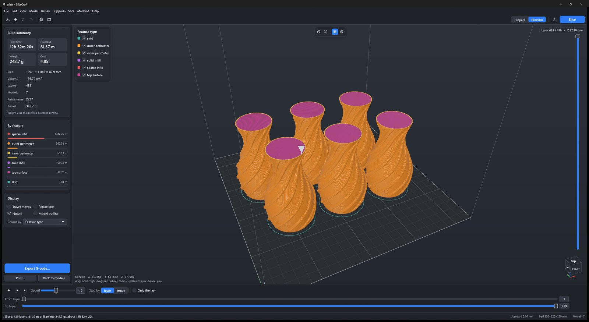
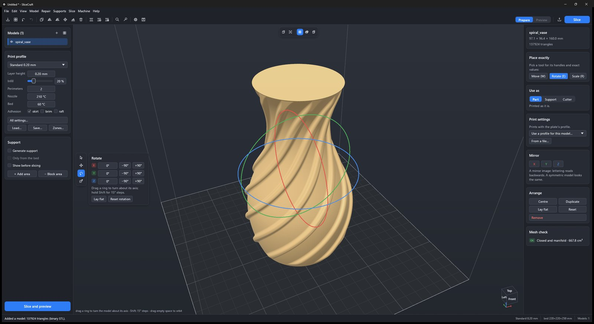
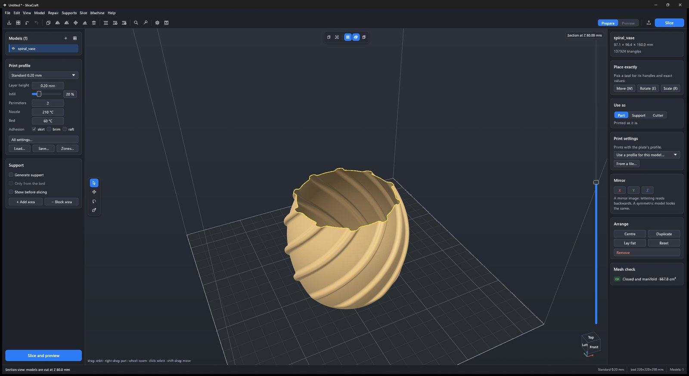
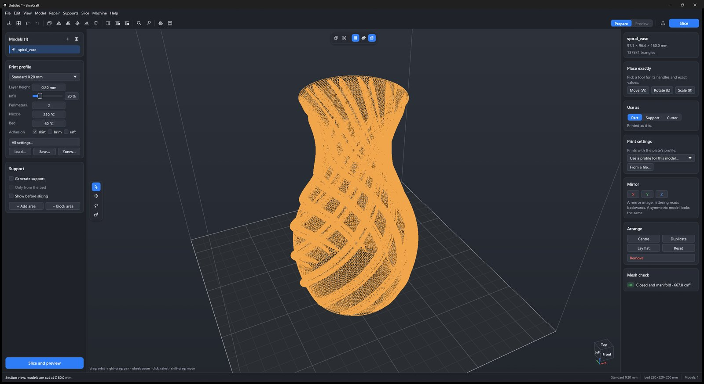
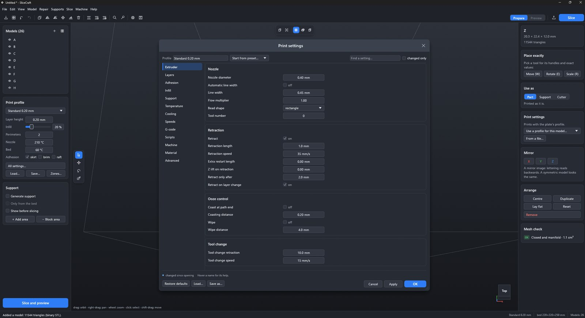
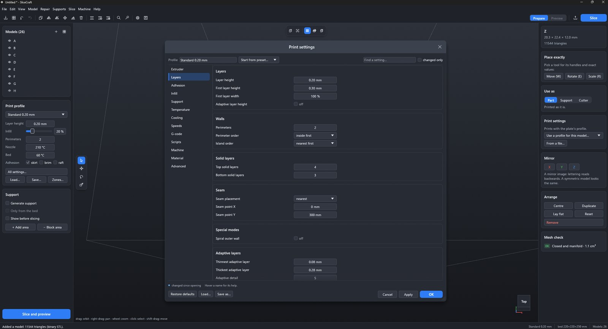
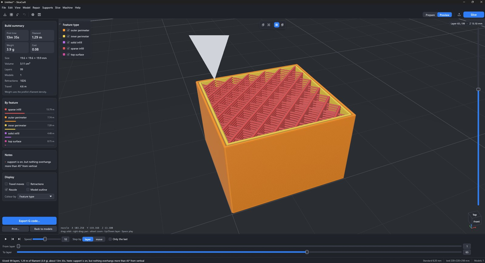

<h1 align="center">SliceCraft</h1>

<p align="center">
  <b>An open-source 3D print slicer, written from scratch in pure Rust.</b>
</p>

<p align="center">
  
  
  
</p>

<p align="center">
  
</p>

SliceCraft does what a slicer does: import models, place them on a bed, choose a
profile, slice them into layers of walls, infill and support, preview the toolpaths
and write G-code for a real printer. The target is the feature set of the
established desktop slicers; the implementation is our own. Every action is also a
command that the window, a scriptable command line and AI agents (over MCP) share.

**SliceCraft is a candidate member of the ArtCraft crafting-app suite.** Membership
is pending; nothing here claims approval.

## Screenshots

| | |
|---|---|
|  |  |
| Preview by layer: walls, infill and top surfaces as lit beads | Vase mode: the outer wall as one rising spiral |
|  |  |
| Many models on a plate, each with its own skirt | Move, rotate and scale with handles and exact values |
|  |  |
| Section view: cut the models at a height | Wireframe view |
|  |  |
| The profile editor: every setting, grouped and searchable | Layers, walls, seams and special modes |
|  | |
| Stepping through a job: walls, infill and the nozzle | |

The vase in the screenshots is *Spiral vase* by JJ76, used under CC BY (see
[ATTRIBUTION.md](ATTRIBUTION.md)).

## What it does

- **Models:** STL, OBJ and 3MF import (and export); move, rotate, scale and mirror
  with handles or exact values; arrange, lay flat, group, cut, repair, reduce, hollow;
  models as parts, as support or as cutters.
- **Slicing:** walls (inside or outside first), solid and sparse infill (rectilinear,
  grid, triangles, honeycomb, gyroid, wiggle, cubic, octahedral, concentric), thin
  walls and gap fill, bridges, ironing, adaptive layers, vase mode, skirt, brim, raft,
  automatic support (pillars or areas) with manual add and block, several tools with
  a prime tower and an ooze shield, one model at a time.
- **Profiles:** about 170 settings, all used by the slicer; several profiles per job,
  by height or by model; Simplify3D `.fff` profiles (and the settings header of its
  G-code) import directly.
- **Preview:** drawn on the graphics card (wgpu) with lit beads, depth and
  anti-aliasing; by layer or by move, coloured by feature, speed, height, tool or
  flow; build time, filament, weight and cost.
- **Output:** G-code for Marlin, RepRap and Klipper firmware; binary G-code;
  thumbnails; printing over USB and to OctoPrint or Moonraker.
- **Automation:** a command-line slicer with JSON output, and an MCP server so AI
  agents can drive every command.
- **Interface:** dark and light themes; English and Bulgarian.

**Status.** Every planned feature is in, and the output has been compared side by
side with an established slicer on real jobs
([R10](docs/research/10-s3d-comparison.md)). Nothing has been test-printed yet;
calibration from real prints comes next. Built and run on Windows 11 so far.
[docs/gaps.md](docs/gaps.md) lists what is missing.

## Build and run

You need Rust 1.93 or newer.

```sh
cargo run --release -p slicecraft -- examples/cube.stl     # the window
cargo run --release -p slicecraft-cli -- info examples/cube.stl
cargo run --release -p slicecraft-cli -- slice examples/cube.stl -o cube.gcode --infill 15 --json
cargo run --release -p slicecraft-cli -- mcp               # an MCP server on stdio, for agents
cargo test --workspace
cargo xtask ci                  # fmt, clippy -D warnings, tests, layering
```

In the window: drop model files on it or use **Import**, place them with the tools
at the left of the 3D view, pick a profile, press **Slice** (Ctrl+R), scrub layers
with the slider or Up/Down, then **Export G-code** (Ctrl+E).

## The shape

```
geom ─┐        f64 vectors, bounds, meshes, planar regions (offset, booleans)
doc   ┤        scene objects, placement, bed, print profile, validation
render┤        cross sections, loops, shells, infill, path ordering
io    ┤        model files, profiles, G-code, printers
engine┤        session, commands, parallel slicing pipeline
ui-egui · mcp  the window · the agent surface
apps: slicecraft · slicecraft-cli
```

Nothing below `ui-egui` knows a window exists; `cargo xtask layers` enforces it.
Non-test code never panics and has no `unsafe`.

## Documentation

| Document | What it holds |
|---|---|
| [docs/architecture.md](docs/architecture.md) | How the code is built |
| [docs/research/](docs/research/README.md) | Research notes: feature inventory, support, extrusion model, profile import, side-by-side comparison |
| [docs/gaps.md](docs/gaps.md) | Everything still missing |
| [ROADMAP.md](ROADMAP.md) | Stage, headline numbers, what is next |
| [docs/PLAN.md](docs/PLAN.md) | The program plan: phases, estimates, risks |
| [AGENTS.md](AGENTS.md) | The rules for contributors and agents: clean room, never crash, layering |
| [SECURITY.md](SECURITY.md) | How to report a vulnerability |

## Clean room

SliceCraft learns from observed behaviour and public specifications. It contains no
code, user-visible text, profiles, icons or artwork from any other slicer. Simplify3D
is a trademark of its owner; SliceCraft is not affiliated with or endorsed by it.

## Licence

MIT OR Apache-2.0, at your option ([LICENSE-MIT](LICENSE-MIT),
[LICENSE-APACHE](LICENSE-APACHE)). Third-party crates and assets are listed in
[ATTRIBUTION.md](ATTRIBUTION.md).
